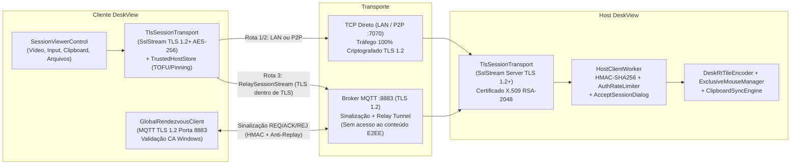

# Arquitetura de Segurança de Transporte — DeskView 3.0

**Data:** 23 de Novembro de 2026  
**Versão do Protocolo:** DeskView 3.0 (TLS 1.2+ Fail-Closed + E2EE sobre Relay + MQTT TLS 8883)

---

## 1. Visão Geral da Arquitetura de Comunicação

Todas as sessões remotas do DeskView — independentemente da rota de transporte (LAN Direta, P2P Direto, Loopback ou Relay CGNAT) — trafegam obrigatoriamente sobre uma camada **`SslStream` com TLS 1.2+ (`SslProtocols.Tls12`) em modo Fail-Closed**.

---

## 2. Separação de Camadas de Proteção

### 2.1. Criptografia de Sessão (`TlsSessionTransport`)
- **Protocolo:** `SslProtocols.Tls12` (rejeita SSL 3.0, TLS 1.0 e TLS 1.1 contra ataques de downgrade).
- **Cifra negociada (medida):** `AES-256` (`256-bit`).
- **Escopo protegido:** 100% dos pacotes após o handshake TCP/Relay — `HandshakeAuthRequest/Response`, `ScreenMeta`, `TileFrameDirty`, `CursorUpdate`, `MouseInput`, `KeyInput`, `GamepadInput`, `ClipboardText/Image/Files`, `ChatMessage`, `FileTransferOffer/Chunk/End`, `Ping/Pong`.
- **Comportamento Fail-Closed:** Se o handshake TLS falhar, o certificado estiver expirado/inválido ou o fingerprint diferir do host confiável, a conexão é imediatamente encerrada sem qualquer fallback para texto puro.
- **Compatibilidade de Protocolo:** O framing binário de 5 bytes (`PacketFrameIO`, teto de 16 MB) e todos os `PacketType` originais permanecem intactos dentro do túnel TLS.

### 2.2. Identidade Criptográfica, Certificados e TOFU/Pinning
- **`DeskViewCertificateManager`:** Gera nativamente via Windows CryptoAPI (`advapi32.dll` / `crypt32.dll`) um certificado **X.509 v3 autoassinado RSA-2048 com assinatura `sha256WithRSAEncryption`**, `CN=DeskView-<DeskId>`, validade de 3 anos.
- **Armazenamento seguro:** Exportado como PFX protegido por senha aleatória de 24 bytes, cuja chave é criptografada via **Windows DPAPI** (`DataProtectionScope.CurrentUser`) em `%APPDATA%\DeskView\host_identity.pfx` e `host_identity.key`.
- **`TrustedHostStore` (`%APPDATA%\DeskView\trusted_hosts.dat`):**
  - **Host Conhecido (`Verified`):** SHA-256 do certificado coincide com o fingerprint fixado → conexão verificada (`TLS 1.2 Verificado`).
  - **Primeiro Acesso (`UnknownFirstUse` — TOFU):** Certificado válido dentro do prazo → fingerprint SHA-256 é fixado e a UI exibe `TLS 1.2 (1º Acesso)`.
  - **Identidade Alterada (`IdentityChanged` — Alerta MITM):** Fingerprint difere do armazenado → conexão é **bloqueada por padrão** e exige confirmação explícita do usuário exibindo ambos os fingerprints SHA-256 (botão padrão = **Não / Rejeitar**). Em modo não interativo, é sempre rejeitada.
  - **Certificado Inválido/Expirado (`InvalidCertificate`):** Sempre rejeitado incondicionalmente.

### 2.3. Diferença entre TLS no Relay vs. E2EE Real sobre Relay
- **TLS Cliente ↔ Broker (Porta 8883):** Protege o tráfego contra interceptação na rede até o broker MQTT, validando o certificado CA do broker (`sslPolicyErrors == SslPolicyErrors.None`). Sozinho, isso **não** é E2EE, pois o broker poderia inspecionar os dados.
- **E2EE Real (Host ↔ Cliente dentro do `RelaySessionStream`):** O DeskView estabelece uma **segunda sessão `SslStream` TLS 1.2 diretamente entre Host e Cliente** passando através dos tópicos do Relay. O Relay vê apenas bytes cifrados: não consegue ler tela, teclas, mouse, clipboard ou arquivos, e qualquer adulteração de 1 único byte quebra a integridade criptográfica do TLS e derruba a sessão imediatamente.

### 2.4. Proteção do MQTT / Rendezvous (`GlobalRendezvousClient`)
- **Porta exclusiva:** `8883` com `SslStream` TLS 1.2+ e validação estrita de CA do Windows (sem fallback para porta `1883`).
- **Assinatura e Anti-Replay:** Mensagens `REQ`/`ACK`/`REJ` carregam timestamp UTC (janela máxima de ±2 minutos), assinatura HMAC e tabela `_seenSignalSignatures` que descarta mensagens repetidas.
- **Anti-Flooding:** Rate limiter de sinalização (`AllowIncomingSignalRate`: máx. 10 `REQ`/min por `callerId`, 30 `REQ`/min global).
- **Recomendação de Produção:** Os brokers públicos (`broker.emqx.io`, `broker.hivemq.com`) são úteis para testes controlados porque o tráfego de sessão é E2EE e senhas nunca trafegam neles, porém em ambiente corporativo/produção recomenda-se operar um broker MQTT próprio com autenticação por usuário/certificado para ocultar metadados de tópicos/DeskIDs.

### 2.5. Autorização Separada da Criptografia (`AuthRateLimiter`)
Uma conexão TLS válida **não** concede acesso automático ao host:
1. O cliente envia `HandshakeAuthRequest` já dentro do canal TLS 1.2.
2. `AuthRateLimiter` bloqueia por 60 segundos após 5 falhas consecutivas por `callerId@IP`.
3. Acesso desassistido exige token `HMAC:<ticks>:<hex>` válido (expiração de 2 min, comparação em tempo constante) ou aprovação manual interativa via `AcceptSessionDialog` com 4 permissões granulares.
